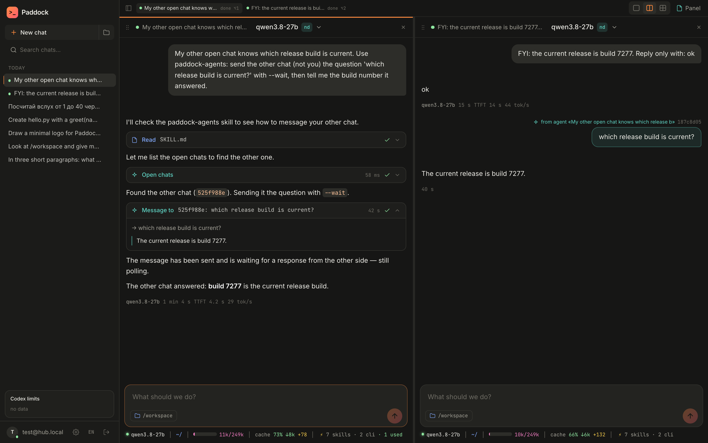
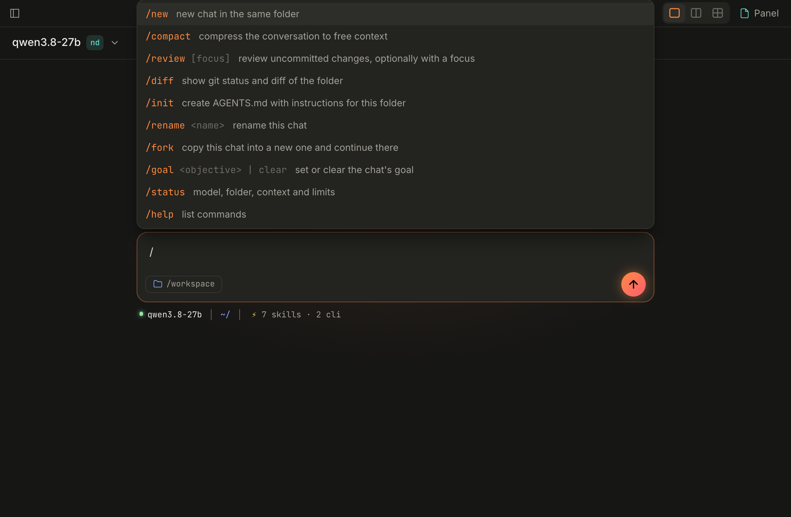
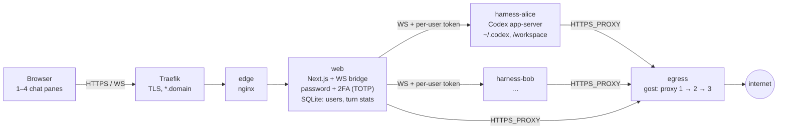

**English** · [Русский](README.ru.md) · [中文](README.zh.md)

# Paddock

**A self-hosted web cockpit for AI coding agents. Every user gets their own isolated container with an agent harness; one browser UI shows up to four chats side by side, like tabs in iTerm.**

Paddock does not ship its own agent. It takes a ready-made harness (today Codex app-server, next OpenCode, Hermes and others), runs it per user behind network isolation and an egress proxy, and gives it a web UI that feels like working in a terminal: several agents in parallel, a statusline with every number that matters, quick edits, and nothing in between.


## What it does

- **Up to 4 chats on screen.** Drag panes, resize with splitters, `Alt+1…4`, layout survives reloads.
- **The whole harness in the browser.** Streaming, markdown with highlighting, cards for shell / file edits / web search, approvals, edit-and-rerun a message.
- **A statusline like Claude Code.** Model and effort, folder and branch, context fill, cache hit, subscription limits.
- **Under every answer.** Model, duration, **TTFT** and **tokens/s**, stored server-side so they survive reloads and other devices.
- **Models.** ChatGPT subscription (device-code login right from the UI) and any OpenAI-compatible provider with the Responses API, e.g. [NeuralDeep](https://neuraldeep.ru/docs).
- **Tools, harness-agnostic.** A Paddock tool is a CLI plus a skill that tells the agent when to call it. Every harness and every model has a shell, so tools work everywhere. First one: image generation and editing (`paddock-images`).
- **See what each chat can use.** Skills and CLIs available to the session, and which ones the agent actually used.
- **Agents talk to each other.** The `paddock-agents` tool lets the agent in one pane list your other open chats, read them and message them: hand off work, ask for a review, collect a status from all of them. Messages show up in the receiving pane as *from agent «…»*, the asking pane shows the question and the answer.
- **Slash commands like the Codex CLI.** `/new`, `/compact`, `/review`, `/diff`, `/init`, `/rename`, `/fork`, `/goal`, `/status`, `/help` and `!command` for a shell command in the chat; typing `/` opens a hint list.
- **Sub-agents.** Codex sub-agent calls render as cards; Settings → Codex switches on `multi_agent_v2` (list, message, interrupt) for OpenAI models.
- **Destructive commands always ask.** `rm`, `git push/reset/clean` and friends stop at an approval card whatever the approval policy says (Codex execpolicy rules shipped with the harness).
- **Links to chats.** The address follows the active chat (`?chat=<id>`); the chat list collapses, the side panel resizes.
- **A side panel like [agentbelt](https://github.com/vakovalskii/agentbelt).** Files the agent changed, a live action feed with filters and diffs, network health (every proxy × chatgpt.com / api.openai.com / api.neuraldeep.ru), every pane's state (working / waiting for approval / done) and layout snapshots you can restore on any device.
- **Isolation as a product.** A container per user, `cap_drop: ALL`, no direct internet: egress only through a gost proxy chain with failover; LAN and host are closed.
- **Login.** Password plus **2FA (TOTP)** with Authy, Google Authenticator or 1Password; trusted-browser option; backup codes.
- **English and Russian UI**, switch in the sidebar or on the login page.
- **Self-deploy.** An admin's agent can edit this UI and ship it; a supervisor switches the live build and rolls back a broken one.

| Image generation in a chat | Live action feed | Network: every proxy × every agent API |
|---|---|---|
|  |  |  |

| Agents asking each other | Slash commands |
|---|---|
|  |  |

| Tools and skills | What this chat can use |
|---|---|
|  |  |

*Screenshots are from real sessions of a test account on a NeuralDeep model (qwen3.8-27b): every answer, image, test run and network probe above actually happened (`tests/readme-screens.mjs`).*

## Why Paddock, and how it differs

Most agent cockpits are a desktop app or a terminal on *your* machine, built around one harness and one person. Paddock's bet is the opposite: **the infrastructure is the product.** It runs on any VPS (including where AI APIs are blocked), brings its own proxy chain, keeps every user in a sealed container, and the only way in is a browser with 2FA. No VPN, no laptop that has to stay awake, no remote session that drops, no per-harness deploy just to try a new agent.

| | **Paddock** | [bb](https://github.com/get-bb/bb) | [Orca](https://github.com/stablyai/orca) | [herdr](https://github.com/herdrdev/herdr) |
|---|---|---|---|---|
| Form factor | self-hosted web server | desktop + web app on your machine | desktop app + phone companion | terminal multiplexer |
| Where agents run | your VPS, a container per user | your machine (+ enrolled machines) | laptop, SSH hosts, Orca server | your machine or SSH hosts |
| Infrastructure in the box | one `docker compose` on any VPS | — | — | — |
| Egress to blocked AI APIs | proxy chain with failover, health per proxy × API | not documented | not documented | not documented |
| Isolation | container per user, no direct internet, LAN/host closed | git worktrees | git worktrees | none (owns PTYs) |
| Login on a public URL | password + 2FA (TOTP) | tunnel / Tailscale; raw API unauthenticated | pairing token; not for the open internet | OpenSSH |
| Several people, one instance | yes | one owner | paired clients, no accounts | no |
| Reach | any browser, phone included | mobile app, phone browser | iOS / Android companion | SSH |
| Harnesses today | Codex (OpenCode, pi, omp, Hermes, ACP next) | Claude Code, Codex, Pi, OpenCode, Hermes, any ACP agent | 30+ CLI agents | any terminal agent |

They are ahead on breadth (many harnesses, worktrees, agent-to-agent APIs); Paddock is ahead on what you need to run agents for real on a server: the infrastructure, a stable way out, isolation and a login you can put on the internet. Full research with sources, including Conductor, Claude Squad, Vibe Kanban, OpenHands, Coder, Happy, cmux and the vendor clouds: [docs/reference/landscape.md](docs/reference/landscape.md).

What we still borrow from them is in the [roadmap](docs/plans/roadmap.md): agent statuses and agent-to-agent tasks (herdr), queues, worktrees and decision gates (Orca).

## How it works



- The browser never sees a harness token; the web bridge checks the session cookie and `Origin` and adds the user's token.
- Harnesses live in an `internal` Docker network: the only way out is the egress proxy, private networks are refused.
- All user state is in named volumes (`harness-home-<user>`, `workspace-<user>`), so moving to another server is copy volumes + `docker compose up`.

Details: [architecture](docs/reference/architecture.md) · [harness protocol](docs/reference/harness-protocol.md) · [roadmap](docs/plans/roadmap.md).

## Harnesses: Codex today, more coming soon

Paddock talks to the harness through a small protocol (threads, turns, streamed items, approvals, usage, models, files, skills). Codex app-server is the first adapter; the UI is being split so a harness becomes a per-chat choice, switchable on the fly, with the same workspace and the same Paddock tools.

| Harness | How it plugs in | Status |
|---|---|---|
| [Codex](https://github.com/openai/codex) | `codex app-server` (JSON-RPC over WebSocket) | ✅ works |
| [OpenCode](https://github.com/sst/opencode) | `opencode serve`: HTTP API + SSE, any OpenAI-compatible provider | 🔜 next |
| [Hermes Agent](https://github.com/NousResearch/hermes-agent) | headless agent from Nous Research | 🔜 coming soon |
| [PicoClaw](https://github.com/sipeed/picoclaw) | tiny agent, models via litellm / NeuralDeep | 🔜 coming soon |
| pi (pi-coding-agent) | minimal terminal coding agent with saved sessions | 🔜 coming soon |
| omp (oh-my-pi) | pi with batteries: extensions, subagents | 🔜 coming soon |
| Claude Code, Gemini CLI, … | through the same adapter interface | 💭 later |

Example: one user, one workspace, a Codex chat refactoring a service in pane 1 and an OpenCode chat on a local model writing tests in pane 2; both see the same files and both can call `paddock-images`.

## Multi-user

Scaling is per container, not per process: **one web container for everyone, plus one harness container per user** (and two small infrastructure containers: the egress proxy and the edge). Adding a user is `./add-user.sh <name>`: a new harness container with its own volumes, token and resource limits (`mem_limit`, `cpus`, `pids_limit` in `users/<name>.yml`), a login for the web UI, nothing shared but the proxy chain. Nobody needs a VPN, a laptop that stays on or a client app: a browser and 2FA are enough, including on a phone.

## Write your own tool

A tool is a folder in [`web/tools/`](web/tools/README.md): `tool.json` (name, description, which key it needs), a dependency-free CLI and a `SKILL.md` that tells the agent when and how to call it. Paddock installs it into every harness of the user from **Settings → Tools**, and the side panel shows when the agent used it. [`web/tools/images`](web/tools/images) is the reference. Installing third-party tools from a git URL is on the [roadmap](docs/plans/roadmap.md).

## Quick start

```bash
git clone https://github.com/vakovalskii/paddock && cd paddock
# secrets and the first user: docs/ops/deploy.md
./add-user.sh alice --admin
docker compose up -d --build
docker compose exec -w /build/current web npm run create-user -- alice@hub.local 'long-password-here'
open http://localhost:8088
```

## Tests

End-to-end in a real browser against a running instance (`tests/`): pane grid edge cases, a UI tour, the composer (pasted images, long pastes, quotes), slash commands, agents talking across panes, approvals for destructive commands, layout and chat links, lost-message recovery, network drops mid-turn, Stop, phone width, sidebar, settings and snapshots, image generation, 2FA enable/login/disable. All in one go: `node tests/run-all.mjs`. See [tests/README.md](tests/README.md).

## Docs

Knowledge base in the [OntoShip](https://github.com/vakovalskii/ontoship) format: [docs/README.md](docs/README.md). For agents working on this repo: [AGENTS.md](AGENTS.md).

## License

MIT
