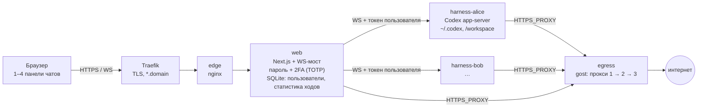

[English](README.md) · **Русский** · [中文](README.zh.md)

# Paddock

**Self-hosted веб-кокпит для AI-агентов, которые пишут код. У каждого пользователя свой изолированный контейнер с харнессом агента; в одном веб-интерфейсе до четырёх чатов рядом, как вкладки в iTerm.**

Своего агента в Paddock нет. Он берёт готовый харнесс (сейчас Codex app-server, дальше OpenCode, Hermes и другие), запускает его отдельно для каждого пользователя за сетевой изоляцией и egress-прокси и даёт веб-интерфейс, в котором работается как в терминале: несколько агентов параллельно, статусная строка со всеми важными цифрами, быстрые правки и ничего лишнего между вами и агентом.


## Что умеет

- **До 4 чатов на экране.** Панели перетаскиваются, размер меняется сплиттерами, `Alt+1…4`, раскладка переживает перезагрузку.
- **Весь харнесс в браузере.** Стриминг, markdown с подсветкой, карточки для shell / правок файлов / веб-поиска, подтверждения, правка сообщения с перезапуском.
- **Статусная строка как в Claude Code.** Модель и effort, папка и ветка, заполненность контекста, попадания в кеш, лимиты подписки.
- **Под каждым ответом.** Модель, время, **TTFT** и **токены/с**; хранятся на сервере, поэтому видны после перезагрузки и с других устройств.
- **Модели.** Подписка ChatGPT (вход по device code прямо из интерфейса) и любой OpenAI-совместимый провайдер с Responses API, например [NeuralDeep](https://neuraldeep.ru/docs).
- **Инструменты, не привязанные к харнессу.** Инструмент Paddock — это CLI плюс скилл, который подсказывает агенту, когда его вызывать. Shell есть у любого харнесса и любой модели, так что инструменты работают везде. Первый — генерация и редактирование картинок (`paddock-images`).
- **Видно, что доступно чату.** Скиллы и CLI, доступные сессии, и какие из них агент реально использовал.
- **Боковая панель как в [agentbelt](https://github.com/vakovalskii/agentbelt).** Файлы, которые поменял агент, живая лента действий с фильтрами и диффами, состояние сети (каждый прокси × chatgpt.com / api.openai.com / api.neuraldeep.ru), состояние каждой панели (работает / ждёт подтверждения / готово) и снимки раскладки, которые можно восстановить на любом устройстве.
- **Изоляция как часть продукта.** Контейнер на пользователя, `cap_drop: ALL`, прямого выхода в интернет нет: наружу только через прокси-цепочку gost с failover; LAN и хост закрыты.
- **Вход.** Пароль плюс **2FA (TOTP)** через Authy, Google Authenticator или 1Password; доверенный браузер; резервные коды.
- **Интерфейс на английском и русском**, переключается в сайдбаре или на странице входа.
- **Самодеплой.** Агент админа может править этот интерфейс и выкатывать его; супервизор переключает живую сборку и откатывает сломанную.

| Генерация картинок в чате | Живая лента действий | Сеть: каждый прокси × каждый API агентов |
|---|---|---|
|  |  |  |

| Инструменты и скиллы | Что доступно этому чату |
|---|---|
|  |  |

*Скриншоты сняты с реальных сессий тестового аккаунта на модели NeuralDeep (qwen3.8-27b): каждый ответ, картинка, прогон тестов и проверка сети выше действительно были (`tests/readme-screens.mjs`).*

## Зачем Paddock и чем он отличается

Большинство кокпитов для агентов — это десктопное приложение или терминал на *вашей* машине, заточенные под один харнесс и одного человека. Paddock ставит на обратное: **инфраструктура и есть продукт.** Он работает на любом VPS (в том числе там, где AI API заблокированы), приносит свою прокси-цепочку, держит каждого пользователя в закрытом контейнере, а войти можно только через браузер с 2FA. Без VPN, без ноутбука, который нельзя закрывать, без отваливающейся удалённой сессии и без отдельного деплоя под каждый харнесс ради того, чтобы попробовать нового агента.

| | **Paddock** | [bb](https://github.com/get-bb/bb) | [Orca](https://github.com/stablyai/orca) | [herdr](https://github.com/herdrdev/herdr) |
|---|---|---|---|---|
| Форм-фактор | self-hosted веб-сервер | десктоп + веб-приложение на вашей машине | десктопное приложение + компаньон на телефоне | терминальный мультиплексор |
| Где работают агенты | ваш VPS, контейнер на пользователя | ваша машина (+ подключённые машины) | ноутбук, SSH-хосты, сервер Orca | ваша машина или SSH-хосты |
| Инфраструктура в комплекте | один `docker compose` на любом VPS | — | — | — |
| Выход к заблокированным AI API | прокси-цепочка с failover, здоровье по каждой паре прокси × API | не описано | не описано | не описано |
| Изоляция | контейнер на пользователя, без прямого интернета, LAN/хост закрыты | git worktrees | git worktrees | нет (владеет PTY) |
| Вход по публичному URL | пароль + 2FA (TOTP) | туннель / Tailscale; голый API без авторизации | токен сопряжения; не для открытого интернета | OpenSSH |
| Несколько человек на одном инстансе | да | один владелец | сопряжённые клиенты, без аккаунтов | нет |
| Откуда доступен | любой браузер, включая телефон | мобильное приложение, браузер на телефоне | компаньон для iOS / Android | SSH |
| Харнессы сейчас | Codex (дальше OpenCode, pi, omp, Hermes, ACP) | Claude Code, Codex, Pi, OpenCode, Hermes, любой ACP-агент | 30+ CLI-агентов | любой терминальный агент |

Они впереди по широте (много харнессов, worktrees, API агент-агент); Paddock впереди в том, что нужно, чтобы по-настоящему гонять агентов на сервере: инфраструктура, стабильный выход наружу, изоляция и вход, который не страшно выставить в интернет. Полное исследование с источниками, включая Conductor, Claude Squad, Vibe Kanban, OpenHands, Coder, Happy, cmux и облака вендоров: [docs/reference/landscape.md](docs/reference/landscape.md).

Что мы всё-таки у них заимствуем — в [роадмапе](docs/plans/roadmap.md): статусы агентов и задачи агент-агент (herdr), очереди, worktrees и точки принятия решений (Orca).

## Как устроено



- Браузер никогда не видит токен харнесса; веб-мост проверяет cookie сессии и `Origin` и подставляет токен пользователя.
- Харнессы живут во `internal` Docker-сети: наружу только через egress-прокси, приватные сети запрещены.
- Всё состояние пользователей лежит в именованных томах (`harness-home-<user>`, `workspace-<user>`), так что переезд на другой сервер — это скопировать тома + `docker compose up`.

Подробнее: [архитектура](docs/reference/architecture.md) · [протокол харнесса](docs/reference/harness-protocol.md) · [роадмап](docs/plans/roadmap.md).

## Харнессы: сейчас Codex, скоро больше

Paddock общается с харнессом через небольшой протокол (треды, ходы, стриминг элементов, подтверждения, usage, модели, файлы, скиллы). Codex app-server — первый адаптер; интерфейс разделяется так, чтобы харнесс выбирался для каждого чата и переключался на лету, с тем же workspace и теми же инструментами Paddock.

| Харнесс | Как подключается | Статус |
|---|---|---|
| [Codex](https://github.com/openai/codex) | `codex app-server` (JSON-RPC поверх WebSocket) | ✅ работает |
| [OpenCode](https://github.com/sst/opencode) | `opencode serve`: HTTP API + SSE, любой OpenAI-совместимый провайдер | 🔜 следующий |
| [Hermes Agent](https://github.com/NousResearch/hermes-agent) | headless-агент от Nous Research | 🔜 скоро |
| [PicoClaw](https://github.com/sipeed/picoclaw) | крошечный агент, модели через litellm / NeuralDeep | 🔜 скоро |
| pi (pi-coding-agent) | минималистичный терминальный агент для кода с сохранением сессий | 🔜 скоро |
| omp (oh-my-pi) | pi с батарейками: расширения, сабагенты | 🔜 скоро |
| Claude Code, Gemini CLI, … | через тот же интерфейс адаптера | 💭 позже |

Пример: один пользователь, один workspace, в панели 1 чат на Codex рефакторит сервис, в панели 2 чат на OpenCode с локальной моделью пишет тесты; оба видят одни и те же файлы, и оба могут вызывать `paddock-images`.

## Многопользовательский режим

Масштабирование идёт по контейнерам, а не по процессам: **один web-контейнер на всех плюс по контейнеру с харнессом на каждого пользователя** (и два небольших инфраструктурных контейнера: egress-прокси и edge). Добавить пользователя — `./add-user.sh <name>`: новый контейнер с харнессом, своими томами, токеном и лимитами ресурсов (`mem_limit`, `cpus`, `pids_limit` в `users/<name>.yml`), логин в веб-интерфейс, общая только прокси-цепочка. Никому не нужны VPN, вечно включённый ноутбук или клиентское приложение: хватает браузера и 2FA, в том числе с телефона.

## Свой инструмент

Инструмент — это папка в [`web/tools/`](web/tools/README.md): `tool.json` (имя, описание, какой ключ нужен), CLI без зависимостей и `SKILL.md`, который объясняет агенту, когда и как его вызывать. Paddock ставит его во все харнессы пользователя из **Настройки → Инструменты**, а боковая панель показывает, когда агент им воспользовался. Эталон — [`web/tools/images`](web/tools/images). Установка сторонних инструментов по git URL — в [роадмапе](docs/plans/roadmap.md).

## Быстрый старт

```bash
git clone https://github.com/vakovalskii/paddock && cd paddock
# секреты и первый пользователь: docs/ops/deploy.md
./add-user.sh alice --admin
docker compose up -d --build
docker compose exec -w /build/current web npm run create-user -- alice@hub.local 'long-password-here'
open http://localhost:8088
```

## Тесты

End-to-end в настоящем браузере против запущенного инстанса (`tests/`): краевые случаи сетки панелей, тур по интерфейсу, генерация картинок, включение/вход/отключение 2FA. См. [tests/README.md](tests/README.md).

## Документация

База знаний в формате [OntoShip](https://github.com/vakovalskii/ontoship): [docs/README.md](docs/README.md). Для агентов, которые работают с этим репо: [AGENTS.md](AGENTS.md).

## Лицензия

MIT
