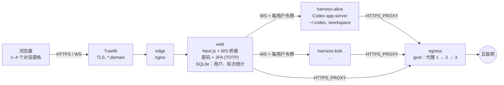

[English](README.md) · [Русский](README.ru.md) · **中文**

# Paddock

**面向 AI 编程 Agent 的自托管 Web 驾驶舱。每个用户都有自己的隔离容器，里面运行一个 Agent 运行环境 (harness)；一个浏览器界面最多可并排显示四个对话，就像 iTerm 里的标签页。**

Paddock 不自带 Agent。它使用现成的 harness（目前是 Codex app-server，接下来是 OpenCode、Hermes 等），在网络隔离和出口代理之后为每个用户单独运行，并提供一个用起来像终端的 Web 界面：多个 Agent 并行、显示所有关键数据的状态栏、快速编辑，中间没有任何多余的东西。


## 功能

- **屏幕上最多 4 个对话。** 拖动窗格、用分隔条调整大小、`Alt+1…4` 切换，布局在刷新后保留。
- **完整的 harness 搬进浏览器。** 流式输出、带语法高亮的 Markdown、shell / 文件编辑 / 网页搜索卡片、审批、编辑消息并重新运行。
- **类似 Claude Code 的状态栏。** 模型与 effort、目录与分支、上下文占用、缓存命中、订阅额度。
- **每条回答下方。** 模型、耗时、**TTFT** 和 **tokens/s**，保存在服务端，刷新后或在其他设备上依然可见。
- **模型。** ChatGPT 订阅（直接在界面中用 device code 登录），以及任何支持 Responses API 的 OpenAI 兼容服务商，例如 [NeuralDeep](https://neuraldeep.ru/docs)。
- **与 harness 无关的工具。** Paddock 工具 = 一个 CLI + 一个告诉 Agent 何时调用它的 skill。所有 harness 和所有模型都有 shell，所以工具在任何地方都能用。第一个工具：图像生成与编辑（`paddock-images`）。
- **查看每个对话可以用什么。** 当前会话可用的 skill 和 CLI，以及 Agent 实际用了哪些。
- **类似 [agentbelt](https://github.com/vakovalskii/agentbelt) 的侧边栏。** Agent 修改过的文件、带过滤和 diff 的实时操作流、网络健康状况（每个代理 × chatgpt.com / api.openai.com / api.neuraldeep.ru）、每个窗格的状态（运行中 / 等待审批 / 已完成），以及可在任意设备上恢复的布局快照。
- **隔离是产品的一部分。** 每用户一个容器，`cap_drop: ALL`，无法直接访问互联网：出口只能经过带故障切换的 gost 代理链；局域网和宿主机均被封闭。
- **登录。** 密码加 **2FA (TOTP)**，支持 Authy、Google Authenticator 或 1Password；可信浏览器选项；备用码。
- **英文和俄文界面**，可在侧边栏或登录页切换。
- **自我部署。** 管理员的 Agent 可以修改这个界面并发布；supervisor 负责切换线上构建，并回滚有问题的版本。

| 在对话中生成图像 | 实时操作流 | 网络：每个代理 × 每个 Agent API |
|---|---|---|
|  |  |  |

| 工具和 skill | 这个对话可以用什么 |
|---|---|
|  |  |

*截图来自测试账号在 NeuralDeep 模型（qwen3.8-27b）上的真实会话：上面的每个回答、图像、测试运行和网络探测都真实发生过（`tests/readme-screens.mjs`）。*

## 为什么选 Paddock，它有何不同

大多数 Agent 驾驶舱是运行在*你自己*机器上的桌面应用或终端，围绕单一 harness 和单个用户构建。Paddock 押注的方向正好相反：**基础设施就是产品。** 它可以运行在任何 VPS 上（包括 AI API 被封锁的地方），自带代理链，把每个用户关在密封的容器里，唯一的入口是带 2FA 的浏览器。不需要 VPN，不需要一直开着的笔记本，不会有断线的远程会话，也不用为了试一个新 Agent 单独部署一套 harness。

| | **Paddock** | [bb](https://github.com/get-bb/bb) | [Orca](https://github.com/stablyai/orca) | [herdr](https://github.com/herdrdev/herdr) |
|---|---|---|---|---|
| 形态 | 自托管 Web 服务 | 运行在你机器上的桌面 + Web 应用 | 桌面应用 + 手机伴侣应用 | 终端复用器 |
| Agent 运行在哪里 | 你的 VPS，每用户一个容器 | 你的机器（+ 已注册的机器） | 笔记本、SSH 主机、Orca 服务器 | 你的机器或 SSH 主机 |
| 开箱即用的基础设施 | 任意 VPS 上一条 `docker compose` | — | — | — |
| 访问被封锁的 AI API | 带故障切换的代理链，按代理 × API 监测健康状况 | 未说明 | 未说明 | 未说明 |
| 隔离 | 每用户一个容器，无直接互联网访问，局域网/宿主机封闭 | git worktrees | git worktrees | 无（直接持有 PTY） |
| 公网 URL 登录 | 密码 + 2FA (TOTP) | 隧道 / Tailscale；原始 API 无鉴权 | 配对令牌；不适合开放互联网 | OpenSSH |
| 多人共用一个实例 | 支持 | 单一所有者 | 已配对客户端，无账号体系 | 不支持 |
| 访问方式 | 任意浏览器，包括手机 | 移动应用、手机浏览器 | iOS / Android 伴侣应用 | SSH |
| 目前支持的 harness | Codex（接下来 OpenCode、pi、omp、Hermes、ACP） | Claude Code、Codex、Pi、OpenCode、Hermes、任意 ACP Agent | 30+ 个 CLI Agent | 任意终端 Agent |

它们在广度上领先（支持很多 harness、worktrees、Agent 间 API）；Paddock 则在真正把 Agent 跑在服务器上所需的东西上领先：基础设施、稳定的出网通道、隔离，以及可以放心暴露到互联网的登录。附带来源的完整调研（包括 Conductor、Claude Squad、Vibe Kanban、OpenHands、Coder、Happy、cmux 以及各厂商云服务）：[docs/reference/landscape.md](docs/reference/landscape.md)。

我们仍在向它们借鉴的内容见 [路线图](docs/plans/roadmap.md)：Agent 状态和 Agent 间任务（herdr），队列、worktrees 和决策关卡（Orca）。

## 工作原理



- 浏览器永远看不到 harness 令牌；Web 桥接层校验会话 cookie 和 `Origin`，再附上该用户的令牌。
- harness 运行在 `internal` Docker 网络中：唯一的出口是出口代理，私有网络一律拒绝。
- 所有用户状态都保存在命名卷中（`harness-home-<user>`、`workspace-<user>`），迁移到另一台服务器只需复制卷 + `docker compose up`。

详情：[架构](docs/reference/architecture.md) · [harness 协议](docs/reference/harness-protocol.md) · [路线图](docs/plans/roadmap.md)。

## Harness：目前是 Codex，更多即将到来

Paddock 通过一个小型协议与 harness 通信（线程、轮次、流式条目、审批、用量、模型、文件、skill）。Codex app-server 是第一个适配器；界面正在拆分，使 harness 成为每个对话可单独选择、可随时切换的选项，并共享同一个 workspace 和同一套 Paddock 工具。

| Harness | 接入方式 | 状态 |
|---|---|---|
| [Codex](https://github.com/openai/codex) | `codex app-server`（基于 WebSocket 的 JSON-RPC） | ✅ 可用 |
| [OpenCode](https://github.com/sst/opencode) | `opencode serve`：HTTP API + SSE，支持任意 OpenAI 兼容服务商 | 🔜 下一个 |
| [Hermes Agent](https://github.com/NousResearch/hermes-agent) | Nous Research 出品的无界面 Agent | 🔜 即将推出 |
| [PicoClaw](https://github.com/sipeed/picoclaw) | 超轻量 Agent，模型通过 litellm / NeuralDeep 接入 | 🔜 即将推出 |
| pi (pi-coding-agent) | 极简的终端编程 Agent，支持保存会话 | 🔜 即将推出 |
| omp (oh-my-pi) | 功能齐全版 pi：扩展、子 Agent | 🔜 即将推出 |
| Claude Code、Gemini CLI、… | 通过同一个适配器接口 | 💭 以后 |

示例：一个用户、一个 workspace，窗格 1 中的 Codex 对话在重构一个服务，窗格 2 中使用本地模型的 OpenCode 对话在写测试；两者看到的是同一批文件，都可以调用 `paddock-images`。

## 多用户

按容器扩展，而不是按进程：**所有人共用一个 web 容器，每个用户一个 harness 容器**（外加两个小型基础设施容器：出口代理和 edge）。添加用户只需 `./add-user.sh <name>`：一个新的 harness 容器，拥有自己的卷、令牌和资源限制（`users/<name>.yml` 中的 `mem_limit`、`cpus`、`pids_limit`），一个 Web 界面登录账号，除代理链外不共享任何东西。谁都不需要 VPN、常开的笔记本或客户端应用：一个浏览器加 2FA 就够了，手机也行。

## 编写你自己的工具

一个工具就是 [`web/tools/`](web/tools/README.md) 下的一个文件夹：`tool.json`（名称、描述、需要哪个密钥）、一个无依赖的 CLI，以及一个告诉 Agent 何时、如何调用它的 `SKILL.md`。Paddock 从 **设置 → 工具** 把它安装到该用户的所有 harness 中，侧边栏会显示 Agent 何时使用了它。参考实现是 [`web/tools/images`](web/tools/images)。通过 git URL 安装第三方工具已列入 [路线图](docs/plans/roadmap.md)。

## 快速开始

```bash
git clone https://github.com/vakovalskii/paddock && cd paddock
# 密钥和第一个用户：docs/ops/deploy.md
./add-user.sh alice --admin
docker compose up -d --build
docker compose exec -w /build/current web npm run create-user -- alice@hub.local 'long-password-here'
open http://localhost:8088
```

## 测试

在真实浏览器中针对运行中的实例做端到端测试（`tests/`）：窗格网格的边界情况、界面导览、图像生成、2FA 启用/登录/停用。见 [tests/README.md](tests/README.md)。

## 文档

[OntoShip](https://github.com/vakovalskii/ontoship) 格式的知识库：[docs/README.md](docs/README.md)。给在本仓库工作的 Agent：[AGENTS.md](AGENTS.md)。

## 许可证

MIT
