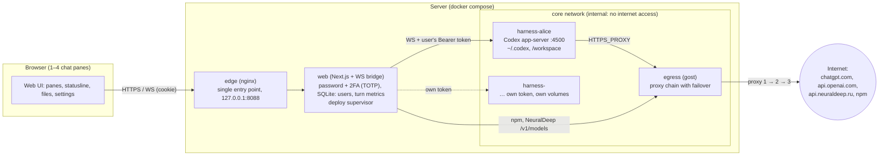
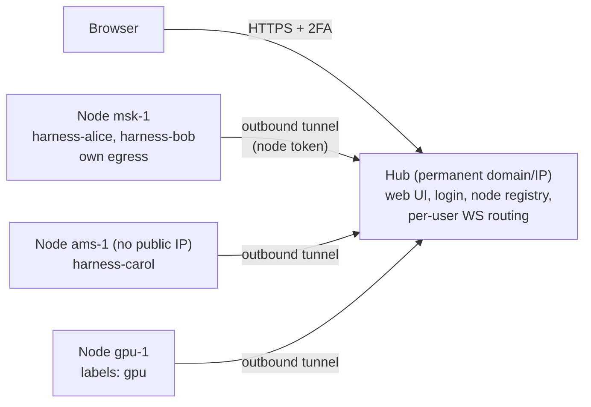

# Paddock architecture — how the pieces connect

## Why it is built this way

The owner works in iTerm: 4–5 tabs, each with an agent on its own task, a statusline at the bottom
(model, folder, context, cache, limits), a side panel with network and actions. Paddock brings
this to the browser in a **simple** way: no agent engine of our own — we take an existing harness
(Codex, later OpenCode, Hermes…) as is, give each user their own container,
and provide one web UI that mirrors the familiar terminal workflow.

## Diagram



ASCII version for the terminal:

```
browser ──HTTPS/WS──▶ edge(nginx) ──▶ web(Next.js, WS bridge) ──WS+token──▶ harness-<user> (Codex app-server)
                                            │                                   │ HTTPS_PROXY
                                            └──────────────▶ egress(gost) ◀─────┘
                                                               │ proxy chain (failover)
                                                               ▼
                                                           internet
```

## What is isolated

| boundary | how | verified |
|---|---|---|
| harness ↔ internet | `core` network with `internal: true`, the only way out is egress | a direct request fails |
| harness ↔ LAN/host/docker0 | egress refuses private networks | curl to 192.168.x or the host is refused |
| user ↔ user | own container, own volumes, own capability token | ⬜ shared `core` network, see roadmap 3.9 |
| web UI login | password 12+ chars and 2FA (TOTP: Authy etc.), rate limit per client IP (X-Forwarded-For from Traefik/edge, only private networks are trusted) | `tests/two-factor.mjs` |
| browser ↔ harness | only the web UI holds the token; the WS bridge checks the cookie session and Origin | 401 without cookie, 403 from a foreign Origin |
| web UI ↔ egress API | gost API only on `core` and behind a password known to the web UI | 401 from a harness |
| containers | `cap_drop: ALL`, `no-new-privileges`, memory/CPU limits | compose |

## Where state lives (everything is portable as volumes — the basis of "mobility")

| volume | what | who writes |
|---|---|---|
| `harness-home-<user>` | `~/.codex`: sessions, archive, config.toml, ChatGPT login, skills, Paddock tools (`paddock/tools/`) | harness; the web UI via its API |
| `workspace-<user>` | `/workspace`: projects, images (`images/`), attachments (`.paddock/uploads/`) | harness |
| `web-data` | `auth.db`: web UI users and sessions | web |
| `web-builds` | current and previous web UI builds | supervisor |
| `secrets/` (directory on the host) | harness tokens, `web.env`, `egress/gost.yaml` with proxy passwords | admin; the web UI (proxies via the gost API) |

Moving to another server = copy `secrets/` and the volumes, then `docker compose up`. Automation: roadmap 3.8.

## Fleet (plan, roadmap 5.8)

Today everything runs on one server. Next, harnesses live not on one VPS but on many, and a user can be assigned a subset. One thing stays fixed: the **hub** has a permanent domain and IP, and it runs the fleet.



- A **node** is installed with one command and a registration token, and connects to the hub by itself: it needs no public IP and no port forwarding.
- The **hub** knows every node (labels, health, load) and, for every user, where their harness is. The browser's WS goes to the hub and then through the tunnel to the right node.
- **Subsets**: a user or a team is assigned a pool by labels (region, GPU, "Russia only", client).
- **Migration**: draining a node and moving a user = exporting/importing their volumes (roadmap 3.8).
- Isolation is the same on every node: an `internal` network, egress only through the proxy.

## The flow of one turn

1. The chat pane sends `turn/start` over WS → the web UI adds the user's token → harness.
2. The harness streams events (`item/*`, `turn/*`, `thread/tokenUsage/updated`) → the web UI dispatches them to panes by `threadId`.
3. An approval request from the harness goes to the pane where its thread is open.
4. Connection drop: after reconnecting, panes re-read the thread from history; nothing is lost.

The protocol between the web UI and harnesses, and the plan for switching harnesses: [harness-protocol.md](harness-protocol.md).
