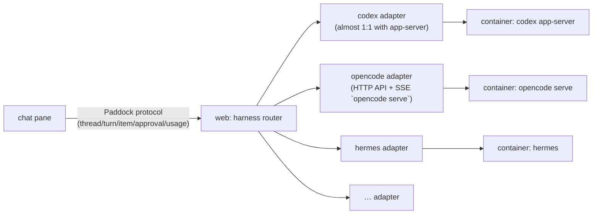

# Harnesses — the web UI protocol and adapters

A **harness** is an existing agent engine (Codex, OpenCode, Hermes…) that runs sessions
and calls the model and tools. Paddock does not rewrite it; it runs it in the user's
container and shows it in the web UI.

## Today

The web UI talks to **Codex app-server** (JSON-RPC 2.0 over WebSocket) directly: `thread/*`,
`turn/*`, `item/*`, `model/list`, `account/*`, `config/*`, `fs/*`. Events are turned into
messages in `web/lib/messages.ts`. This is the fast path, but it ties the web UI to Codex.

## Target design: one web UI protocol + one adapter per harness

The **Paddock protocol** is the minimal common set the web UI already uses:

| entity | what we need from the harness |
|---|---|
| thread | create in a folder, resume, list, archive, name |
| turn | start with text/images, interrupt, roll back to a turn (message editing) |
| item (stream) | answer text, reasoning, shell (command, output, exit code), file edits (diff), MCP/tool, web search |
| approval | approval request → reply allow / allow for session / deny |
| usage | tokens, context window, account limits (if any) |
| models | list of models and reasoning efforts; providers (keys) |
| fs | read a file/image, list folders, create a folder |
| skills/fs | list skills per folder, enable/disable; writing files — this is how Paddock tools (CLI + skill) are installed |

The adapter lives **in the web UI** (TypeScript) and translates the harness's native protocol into this set.
Whatever a harness cannot do, the UI hides (e.g. no rollback means no "edit" button).

## Switching harnesses on the fly

- A user can have several harness containers (`harness-<user>-codex`, `-opencode`…)
  with a **shared** `workspace-<user>` volume: projects and files are shared, sessions are per harness.
- The harness is chosen **per chat** (like the model provider today): the picker gets a "Harness" group.
- Switching the harness in an open chat = a new chat in the same folder (context can be carried over as a summary).
- Paddock tools are CLI + skill, not MCP: every harness and every model has a shell. The web UI installs them into all of a user's harnesses the same way.

## Candidates

| harness | how it connects | status |
|---|---|---|
| Codex | `codex app-server --listen ws://…` (JSON-RPC) | ✅ works |
| OpenCode | `opencode serve` — HTTP API + SSE, OpenAI-compatible providers (NeuralDeep out of the box) | ⬜ verify the API on a live container |
| Hermes | Nous Research agent; needs a proven way to drive it headless | ⬜ verify |
| coddy | ❔ ask the owner what is meant | ❔ |
| PicoClaw | lightweight agent, models via litellm/NeuralDeep | ⬜ |
| pi | pi-coding-agent: minimal terminal agent, sessions in `~/.pi/agent/sessions` (agentbelt already reads them) | ⬜ |
| omp | oh-my-pi: pi with extensions and subagents, sessions in `~/.omp/agent/sessions` | ⬜ |

Order of work is roadmap 3.7: first extract the common interface from `pane.tsx`/`chat.tsx`
into `lib/harness/` (codex adapter = current code), then a second harness (OpenCode),
and only then on-the-fly switching.
